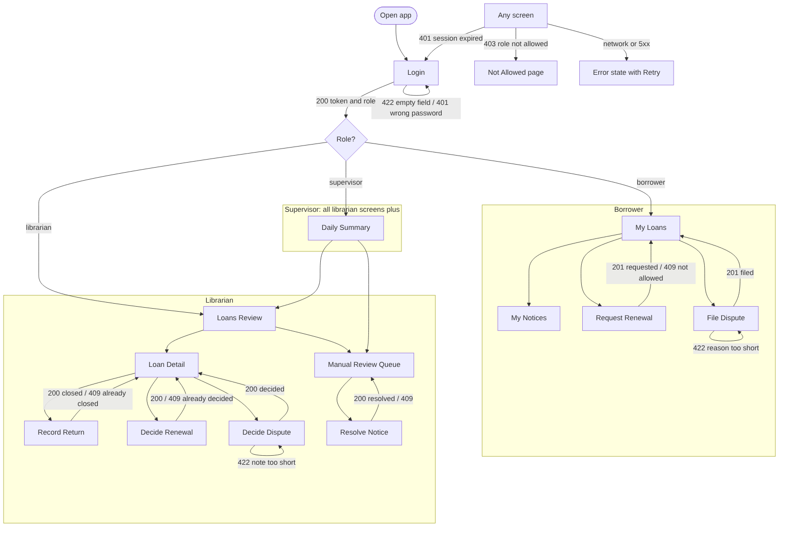
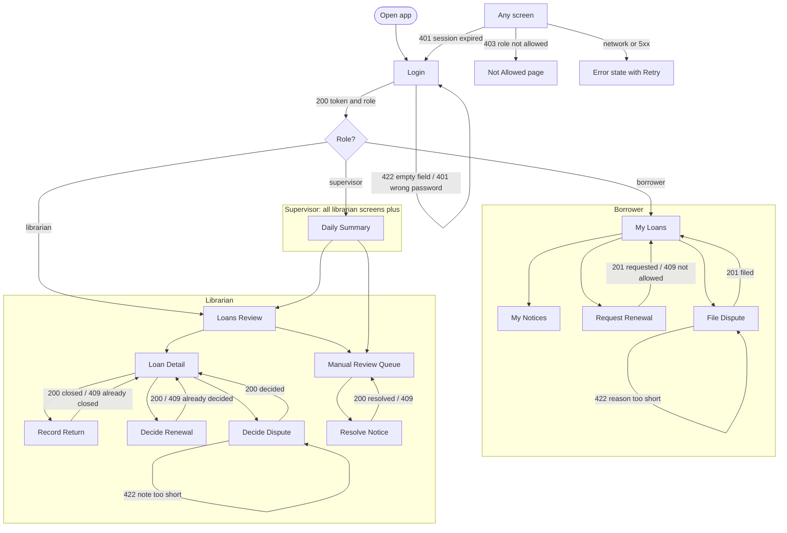

# Flutter Web Screen Flow (SA7 draft)

Project 14, Library Overdue Notification System. Fictional, controlled data only.
Each screen calls only the endpoints listed in `docs/openapi.yaml`. The server enforces roles, so a hidden button is a convenience and never the protection.

## Flow diagram

## Screens

| # | Screen | Roles | API calls | Main actions |
|---|---|---|---|---|
| 1 | Login | everyone | `POST /auth/login` | Sign in. Role decides the first screen |
| 2 | My Loans | borrower | `GET /me/loans` | Open notices, request a renewal, file a dispute (overdue loans only) |
| 3 | My Notices | borrower | `GET /me/notices` | Read reminders and overdue notices received |
| 4 | Request Renewal | borrower | `POST /loans/{id}/renewals` | Confirm the request |
| 5 | File Dispute | borrower | `POST /loans/{id}/disputes` | Enter a reason (10 to 1000 characters) |
| 6 | Loans Review | librarian, supervisor | `GET /loans?status=&page=` | Filter by status, page through, open a loan |
| 7 | Loan Detail | librarian, supervisor | `GET /loans/{id}` | See notices (with last error), renewals, disputes, audit trail |
| 8 | Record Return | librarian, supervisor | `POST /loans/{id}/return` | Close the case |
| 9 | Decide Renewal | librarian, supervisor | `PATCH /renewals/{id}` | Approve or reject |
| 10 | Decide Dispute | librarian, supervisor | `PATCH /disputes/{id}` | Upheld or rejected, with a note (5 to 1000 characters) |
| 11 | Manual Review Queue | librarian, supervisor | `GET /notices?status=manual_review` | See failed notices and why they failed |
| 12 | Resolve Notice | librarian, supervisor | `POST /notices/{id}/resolve` | Record how it was handled, with a note |
| 13 | Daily Summary | supervisor | `GET /summary?date=` | Review failures, recoveries, escalations |

## Required states (every screen that calls the API)

| State | Trigger | What the user sees |
|---|---|---|
| Validation | Empty or short input; server answers 422 | Message under the field. The form keeps what was typed |
| Loading | Request in progress | Progress indicator. Buttons disabled so nothing is sent twice |
| Success | 200 or 201 | Confirmation message, screen refreshes |
| Empty | 200 with an empty list | Friendly text such as "No overdue loans" |
| Authorization (not logged in) | 401 | Back to Login with "Your session has ended" |
| Authorization (wrong role) | 403 | "Not Allowed" page |
| Conflict | 409 | Plain message, for example "This loan has already been returned" |
| Network | No response from the server | "Cannot reach the server" with a Retry button |
| Server error | 5xx | "Something went wrong on our side" with a Retry button |

## Responsive layout

- **Wide (900 px and up):** side navigation, tables, loan detail in two columns.
- **Narrow (under 900 px):** bottom or drawer navigation, lists as cards, forms full width.
- Same screens and same API calls at both sizes. Only the layout changes.

## Rules

- The token is kept in memory only for Week 13, so a page refresh signs the user out. Where to store it is a Week 14 decision.
- Navigation is built from the role returned by login. Screens a role cannot use are not shown, and the server still refuses them.
- Every error is read from one envelope: `{"error": {"code", "message", "fields"}}`.

## Out of scope for SA7

Sign-up, password reset, editing profiles, fines and payments, push notifications.
